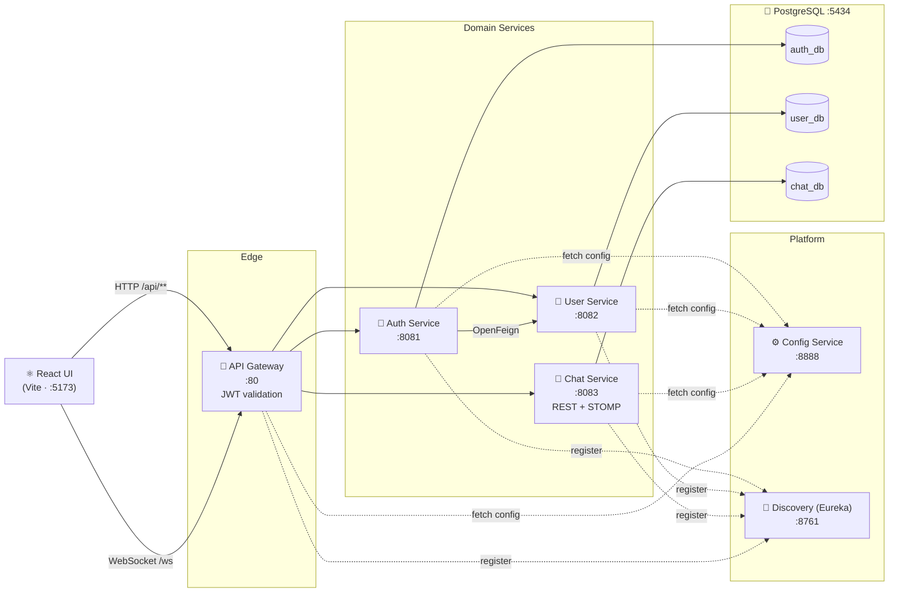

<div align="center">

# 💬 Chat Application

### *Money talks — but **Monji chats.***

A real-time messaging platform built on a Spring Boot microservices backend and a React + TypeScript frontend, with JWT auth, direct & group chats, and live delivery over WebSockets.


</div>

---

## 📑 Table of Contents

- [Features](#-features)
- [Architecture](#-architecture)
- [Services](#-services)
- [Tech Stack](#-tech-stack)
- [Getting Started](#-getting-started)
- [API Reference](#-api-reference)
- [Real-time Messaging](#-real-time-messaging)
- [Project Structure](#-project-structure)
- [Roadmap](#-roadmap)

---

## ✨ Features

| | Feature | Details |
|---|---|---|
| 🔐 | **Secure authentication** | Register / login with JWT access tokens and rotating, hashed refresh tokens stored in HTTP cookies |
| 📱 | **Session limits** | Caps active sessions per user (default: 2) — the oldest session is evicted on a new login |
| 💬 | **Direct chats** | One-to-one conversations between users |
| 👥 | **Group chats** | Create groups, add/remove members, leave groups |
| 🛡️ | **Group roles** | `OWNER`, `ADMIN` and `MEMBER` roles, role updates and ownership transfer |
| ⚡ | **Real-time delivery** | Messages pushed instantly over WebSocket (STOMP) to everyone in the room |
| 🔎 | **User search** | Find people by profile to start a conversation |
| 🚪 | **Single entry point** | API Gateway validates JWTs centrally and forwards trusted identity headers downstream |
| 🧭 | **Service discovery** | Services register with Eureka and are load-balanced by name |
| ⚙️ | **Centralized config** | Shared settings (JWT, routes, CORS) served by Spring Cloud Config |

---

## 🏗️ Architecture



**How a request flows:**

1. The React client calls the **Gateway** (`/api/...`) with an access token (Bearer header, `token` query param, or `access_token` cookie).
2. The Gateway's `GatewayAuthFilter` validates the JWT and injects `X-User-Id`, `X-User-Name` and `X-User-Role` headers.
3. The request is routed by service name through **Eureka** (`lb://auth-service`, `lb://user-service`, `lb://chat-service`).
4. Internal-only endpoints (`/api/users/internal/**`) are blocked at the edge — only services talk to them.

---

## 🧩 Services

| Service | Port | Responsibility |
|---|---|---|
| `config_service` | `8888` | Spring Cloud Config server (native profile) serving files from `config-repo/` |
| `discovery_service` | `8761` | Eureka server for service registration & discovery |
| `gateway_service` | `80` | Spring Cloud Gateway (WebFlux): routing, CORS, JWT validation |
| `auth_service` | `8081` | Registration, login, refresh, logout, session limits; creates user profiles via Feign |
| `user_service` | `8082` | User profiles, lookup and search |
| `chat_service` | `8083` | Chat rooms, members, roles, message history and the STOMP WebSocket broker |
| `common` | — | Shared library: `JwtService`, `ApiResponse` / `ApiError` wrappers, `AppException` |
| `chat-ui/web_app` | `5173` | React 19 + TypeScript + Vite frontend |

---

## 🛠️ Tech Stack

**Backend**
- Java 25, Spring Boot 4.1, Maven multi-module build
- Spring Cloud Gateway (WebFlux), Netflix Eureka, Spring Cloud Config, OpenFeign
- Spring Security, JJWT, Spring Data JPA, Bean Validation, Spring Mail
- Spring WebSocket with a STOMP simple broker

**Frontend**
- React 19, TypeScript, Vite
- `@stomp/stompjs` for the real-time connection

**Infrastructure**
- PostgreSQL 16 via Docker Compose (one database per service)

---

## 🚀 Getting Started

### Prerequisites

- **JDK 25**
- **Maven 3.9+** (or use the bundled `mvnw` wrappers)
- **Node.js 20+** and npm
- **Docker** & Docker Compose

### 1. Clone the repository

```bash
git clone https://github.com/Monji-Kumar/Chat-Application.git
cd Chat-Application
```

### 2. Start PostgreSQL

```bash
docker compose up -d
```

This starts Postgres on **port 5434** and runs `docker/init-db.sh`, which creates `auth_db`, `user_db` and `chat_db`.

### 3. Point the Config Service at `config-repo`

In `config_service/src/main/resources/application.properties`, set the search location to the `config-repo` folder on **your** machine:

```properties
spring.cloud.config.server.native.search-locations=file:///absolute/path/to/Chat-Application/config-repo
```

### 4. Build the project

```bash
mvn clean install -DskipTests
```

### 5. Start the services (in this order)

```bash
# 1 — configuration first
cd config_service    && ./mvnw spring-boot:run
# 2 — service registry
cd discovery_service && ./mvnw spring-boot:run
# 3 — domain services
cd auth_service      && ./mvnw spring-boot:run
cd user_service      && ./mvnw spring-boot:run
cd chat_service      && ./mvnw spring-boot:run
# 4 — the front door
cd gateway_service   && ./mvnw spring-boot:run
```

> 💡 Run each one in its own terminal. Open the Eureka dashboard at **http://localhost:8761** to confirm everything has registered.

> ⚠️ The gateway listens on **port 80**. On Linux/macOS this may need elevated privileges — or change `server.port` in `config-repo/gateway-service.properties` (and the frontend's API base URL to match).

### 6. Start the frontend

```bash
cd chat-ui/web_app
npm install
npm run dev
```

Open **http://localhost:5173**, register two users in two browser windows, and start chatting. 🎉

### Environment & secrets

| Setting | Location |
|---|---|
| JWT secret & token lifetimes | `config-repo/*.properties` (`app.jwt.*`) |
| Database credentials | each service's `application.properties` |
| SMTP (Gmail) credentials | `auth_service` → `spring.mail.*` |
| Max active sessions | `auth_service` → `app.auth.max-active-sessions` |

> 🔒 For anything beyond local development, move these into environment variables or a secrets manager instead of committing them.

---

## 📡 API Reference

All routes go through the gateway at `http://localhost`. Everything except the auth endpoints requires a valid access token.

### 🔐 Auth — `/api/auth`

| Method | Endpoint | Description |
|---|---|---|
| `POST` | `/api/auth/register` | Create an account |
| `POST` | `/api/auth/login` | Log in; sets access & refresh cookies |
| `POST` | `/api/auth/refresh` | Rotate the refresh token and issue a new access token |
| `POST` | `/api/auth/logout` | Revoke the current session |

### 👤 Users — `/api/users`

| Method | Endpoint | Description |
|---|---|---|
| `GET` | `/api/users/me` | Current user's profile |
| `GET` | `/api/users/{authUserId}` | Profile by user id |
| `GET` | `/api/users/search` | Search users |

### 💬 Chats — `/api/chat`

| Method | Endpoint | Description |
|---|---|---|
| `GET` | `/api/chat` | List my chats |
| `POST` | `/api/chat/direct` | Start a direct chat |
| `POST` | `/api/chat/group` | Create a group chat |
| `GET` | `/api/chat/by-room-id` | Chat room details |
| `GET` | `/api/chat/by-room-id/messages` | Message history |
| `POST` | `/api/chat/by-room-id/messages` | Send a message over REST |
| `POST` | `/api/chat/by-room-id/group/add-members` | Add members to a group |
| `DELETE` | `/api/chat/by-room-id/group/remove` | Remove a member |
| `POST` | `/api/chat/by-room-id/group/leave` | Leave a group |
| `PATCH` | `/api/chat/by-room-id/group/role` | Change a member's role |
| `PATCH` | `/api/chat/by-room-id/group/ownership` | Transfer group ownership |

---

## ⚡ Real-time Messaging

The chat service exposes a **STOMP over WebSocket** endpoint, proxied through the gateway.

| | Destination |
|---|---|
| 🔌 Connect | `ws://localhost/ws` (authenticated by the gateway) |
| 📤 Send | `/app/chat/send` |
| 📥 Subscribe | `/topic/chats/{chatRoomId}` |

```ts
import { Client } from "@stomp/stompjs";

const client = new Client({ brokerURL: `ws://${window.location.hostname}/ws` });

client.onConnect = () => {
  client.subscribe(`/topic/chats/${roomId}`, (frame) => {
    const message = JSON.parse(frame.body);
    console.log("New message:", message);
  });

  client.publish({
    destination: "/app/chat/send",
    body: JSON.stringify({ chatRoomId: roomId, content: "Hello! 👋", type: "TEXT" }),
  });
};

client.activate();
```

Every message is persisted first, then broadcast to all subscribers of the room. Supported message types: `TEXT`, `IMAGE`, `FILE`, `VIDEO`, `SYSTEM`.

---

## 📂 Project Structure

```
Chat-Application/
├── common/              # Shared JWT service, API response wrappers, exceptions
├── config_service/      # Spring Cloud Config server
├── config-repo/         # Externalized configuration served to services
├── discovery_service/   # Eureka server
├── gateway_service/     # API gateway + JWT auth filter
├── auth_service/        # Auth, tokens, sessions, email
├── user_service/        # User profiles & search
├── chat_service/        # Rooms, members, messages, WebSocket broker
├── chat-ui/web_app/     # React + TypeScript frontend
├── docker/init-db.sh    # Creates one database per service
├── docker-compose.yml   # PostgreSQL container
└── pom.xml              # Maven parent (multi-module)
```

---

## 🗺️ Roadmap

- [ ] Typing indicators and read receipts
- [ ] Online / last-seen presence
- [ ] Media uploads for `IMAGE`, `FILE` and `VIDEO` messages
- [ ] External message broker (RabbitMQ / Redis) so the chat service can scale horizontally
- [ ] Dockerfiles for every service and a single `docker compose up` for the full stack
- [ ] Broadcast channels (`BROADCAST` room type)

---

## 👨‍💻 Author

**Monji Kumar** — Java / Spring Boot backend developer

[](https://github.com/Monji-Kumar)

---

<div align="center">

### *Time is Monji — thanks for spending some of it here.* 💸

If this project made you smile, drop a ⭐ and let's keep the conversation going.

**Monji, signing off… but always online. 🟢**

</div>
